# Container security lab: the Go hello-server, from image A to image E

My solution to the Chainguard Solutions Engineer technical challenge; the brief is in [CHALLENGE.md](CHALLENGE.md). The app in `go/` is 15 lines of Go that serve "Hello World!" with Gin v1.8.1 and 2021-era dependencies. I packaged it five ways, each changing one thing, scanned every version, and fixed what the scans and a code review found.

This is the public copy of my working repository, published as one commit on top of the challenge's own history. Commit hashes cited in the docs refer to the working repository, which is private.

## Start here

| To read | Where |
|---|---|
| The presentation | [`docs/Chainguard-SE-Challenge-Deck.pdf`](docs/Chainguard-SE-Challenge-Deck.pdf): the talk (slides 1 to 46), then a 17-slide appendix |
| The findings and methodology, in full | [`docs/Findings-and-Methodology-Full-report.pdf`](docs/Findings-and-Methodology-Full-report.pdf), 39 pages (also as [`.docx`](docs/Findings-and-Methodology-Full-report.docx)) |
| The same, as a short read | [`docs/Findings-and-Methodology-Executive-edition.pdf`](docs/Findings-and-Methodology-Executive-edition.pdf), 16 pages (also as [`.docx`](docs/Findings-and-Methodology-Executive-edition.docx)) |
| The numbers | [Results](#results), below, generated from `reports/final/` into [`results.json`](results.json) |
| What happened at each step, and every command | [JOURNAL.md](JOURNAL.md) and [RUNBOOK.md](RUNBOOK.md) |
| The demos: the CI page, the presentation page and the command deck | [The demo console](#the-demo-console-the-ci-demo-the-presentation-and-the-command-deck), below: what each page does, how to run it, and the tmux sessions |

## The exercise

The brief, in [CHALLENGE.md](CHALLENGE.md), asks for four things on a Linux VM with a container engine of my choice, with the tool choices explained:

1. **Containerize** the Go app in `go/` twice: a single-stage and a multi-stage Dockerfile.
2. **Analyse**: scan both images for CVEs, document what was found and compare the two.
3. **Remediate**: patch the app and its dependencies, update the base images, rescan and document the improvement.
4. **Deploy**: run it as a standalone container and show that it works.

The deliverables are the Dockerfiles, the scan reports before and after, and the findings and methodology. The optional bonuses are an SBOM for each image, signed images, a local registry and a Kubernetes deployment; all four are done here. The work is then presented in a 30 to 45 minute talk: the environment and its architecture, then a deep dive into the Dockerfiles, the findings, the remediation and the production challenges of traditional container builds.

Beyond the brief, I added a CI pipeline in which a coding agent writes the change and a supply-chain gate decides whether it ships: see [Beyond the brief](#beyond-the-brief-a-pipeline-with-a-coding-agent).

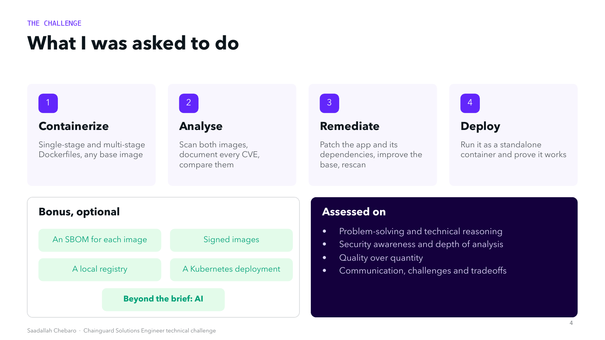

## The approach: one change per image, one owner per layer

Every CVE lives in a layer of the image, and every layer has an owner who can fix it. I split the image into six ownership layers (not the layers `docker history` lists): the OS packages, build tools left in the image, the Go standard library, the Go modules, the app's settings, and how it runs. Layers 3 to 5 all live in one file, the `hello-server` binary, so no base-image change can reach them.

Then I built five images, each changing one thing, so that every drop in the count has one cause and one owner: A to B is the team's packaging, B to C is Chainguard's base, C to D is the team's dependency update, and D to E is the team's own code.

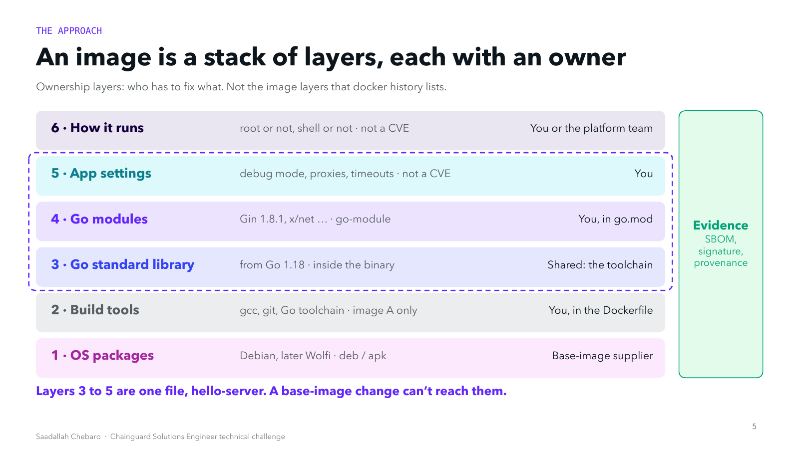

## The lab

Two Ubuntu 24.04 VMs on an Apple Silicon Mac, created with Multipass:

- **The build VM, `chainguard`** (4 CPUs, 4 GB, 192.168.252.2): Docker Engine 29.9.3; the scanners Grype 0.121.3 (primary), Trivy 0.76.2 (second opinion) and govulncheck v1.9.0 (is the vulnerable code in the binary, and is it called?); Syft 1.57.1 for SBOMs; cosign v3.1.4 for signatures; crane for digests; and a local `registry:3` on port 5000. Grype, Trivy and Syft were verified with cosign before use, and Go against go.dev's checksum.
- **The k3s VM, `k3s`** (2 CPUs, 3 GB, 192.168.252.3): k3s v1.37.2, a certified Kubernetes in one binary. On its own VM, it pulls images from the build VM's registry over the network, as a real cluster would.
- **A recorder.** Every command ran in a recorded tmux session: each command, its output and its exit code are in [`logs/`](logs), and screenshots of each step are in [`demo/screenshots/`](demo/screenshots).

Why each tool, and what else was considered: [REPORT.md](REPORT.md) §2.

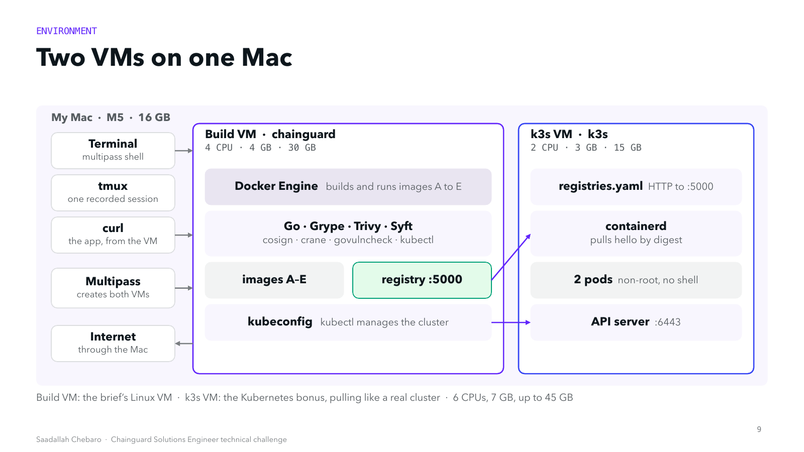

## The five images

| Image | What changes | Dockerfile |
|---|---|---|
| A | The starting point: one stage on `golang:1.18`, so the whole build environment ships | [`Dockerfile.a-single`](dockerfiles/Dockerfile.a-single) |
| B | A multi-stage build: only the binary ships, on `debian:trixie-slim`, as a non-root user | [`Dockerfile.b-multi`](dockerfiles/Dockerfile.b-multi) |
| C | The runtime base becomes `cgr.dev/chainguard/static`, pinned by digest and signature-verified. Nothing else changes | [`Dockerfile.c-chainguard`](dockerfiles/Dockerfile.c-chainguard) |
| D | The dependencies updated: a current Go on `cgr.dev/chainguard/go`, every module updated; the app's own code and settings left as delivered | [`Dockerfile.d-updated`](dockerfiles/Dockerfile.d-updated) |
| E | The app itself fixed: Gin's release mode, no trusted proxies, server timeouts. The same modules, builder and runtime as D | [`Dockerfile.e-patched`](dockerfiles/Dockerfile.e-patched) |

An optional extra build, [`Dockerfile.e-golang`](dockerfiles/Dockerfile.e-golang), is E with Docker's `golang:latest` as the builder, to measure what the builder's brand changes.

Until step 37, image E was called D: it was built at step 13, and its digest, scans, signature and deployment are unchanged. The logs and screenshots of steps 13 to 36 use the old name (JOURNAL step 37).

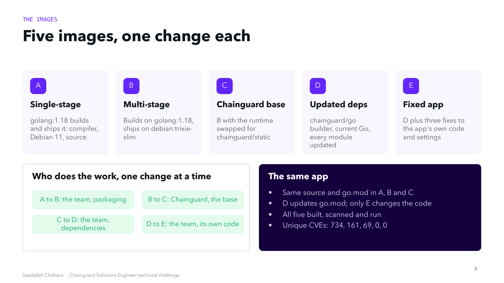

## Results

The rescan of all five images, against the same databases (A, B, C and E within a minute; D, built at step 37, the next day). The tables are generated by `tools/results.sh` from `reports/final/` (the numbers are in [`results.json`](results.json)); none are typed by hand.

<!-- results:start -->
Scanned 2026-11-16T13:45:55Z: Grype 0.121.3 (database built 2026-11-16T06:30:54Z), Trivy 0.76.2 (database updated 2026-11-16T07:10:39.763774809Z), CISA KEV catalog 2026.11.13. Image D, built at step 37, was scanned on 17 November against the same databases. Unique CVE IDs, each at its highest severity (Grype).

| Image | Build stage | Runtime base | Code | Size on disk (compressed) | OS packages | Go modules in the binary | Critical | High | Medium | Low | Negligible | Unknown | Unique CVEs: Grype (Trivy) | On KEV | govulncheck | Runs as | Shell | Hello World! |
|---|---|---|---|---|---|---|---|---|---|---|---|---|---|---|---|---|---|---|
| A | `golang:1.18` | (same image: single stage) | original | 1.49GB (374MB) | 201 debian | 15 (Go v1.18.10) | 46 | 225 | 230 | 38 | 194 | 1 | **734** (10856) | 3 | 62 | root (0:0) | yes | yes |
| B | `golang:1.18` | `debian:trixie-slim` | original | 155MB (35.4MB) | 78 debian | 15 (Go v1.18.10) | 5 | 55 | 59 | 9 | 26 | 7 | **161** (253) | 1 | 62 | 65532:0 | yes | yes |
| C | `golang:1.18` | `cgr.dev/chainguard/static` | original | 19MB (5.62MB) | 3 wolfi | 15 (Go v1.18.10) | 5 | 36 | 26 | 1 | 0 | 1 | **69** (157) | 1 | 62 | 65532:65532 | no | yes |
| D | `cgr.dev/chainguard/go` | `cgr.dev/chainguard/static` | original app, updated modules | 34.9MB (11MB) | 3 wolfi | 19 (Go v1.27.4) | 0 | 0 | 0 | 0 | 0 | 0 | **0** (0) | 0 | 0 | 65532:65532 | no | yes |
| E | `cgr.dev/chainguard/go` | `cgr.dev/chainguard/static` | patched app, updated modules | 34.9MB (11MB) | 3 wolfi | 19 (Go v1.27.4) | 0 | 0 | 0 | 0 | 0 | 0 | **0** (0) | 0 | 0 | 65532:65532 | no | yes |

| Grype, unique IDs by layer | A | B | C | D | E |
|---|---|---|---|---|---|
| 1. OS packages | 603 | 92 | 0 | 0 | 0 |
| 2. Build tools (the Go toolchain, image A) | 118 | 0 | 0 | 0 | 0 |
| 3. Go standard library (every Go program in the image) | 87 | 60 | 60 | 0 | 0 |
| 4. Go modules | 17 | 17 | 17 | 0 | 0 |
| **Total (unique IDs)** | **734** | **161** | **69** | **0** | **0** |
<!-- results:end -->

**How to read it**
- **A → B**, the multi-stage build, removes the build environment: 734 → 161 CVEs, 1.49 GB → 155 MB on disk.
- **B → C**, Chainguard's `static` base, removes every OS CVE (92 → 0), the shell and the package manager, and the process runs as 65532:65532 instead of group root. The binary is byte for byte the same as in A and B, so the 69 left are the app's own.
- **C → D**, the dependency update, is the app team's part. A current Go removes the 60 standard-library CVEs, and the updated `go.mod` the 17 module CVEs: 69 → 0. Building on Docker's `golang:latest` gives the same zero (measured with E's source); the difference is the build environment (325 CVEs in `golang:latest`, one of them on CISA's KEV list, against 0 in `chainguard/go`).
- **D → E changes nothing a scanner sees**: both are at zero, with the same modules. E fixes three things no scanner reports, each tested on D and E side by side: Gin's debug mode, trusting every proxy (D believes a forged client IP), and no server timeouts (D still holds a half-sent request open after 10 seconds; E closes it after 5). Those are the customer's code and settings: no base image fixes them.
- **Zero means no known vulnerabilities in today's databases**, not none. What that leaves, and what I'd do next: [REPORT.md](REPORT.md) §7 and §8.

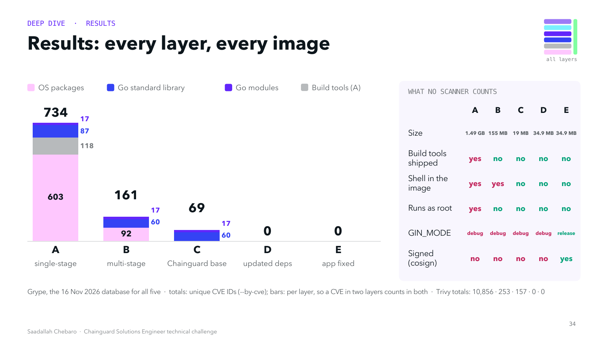

## What a base image can fix, and what it can't

Image C changes one line of B, the runtime base, from `debian:trixie-slim` to `cgr.dev/chainguard/static`. The OS row falls from 92 to 0, but the Go rows don't move: 60 standard-library CVEs and 17 module CVEs, because they travel inside the binary, which is byte for byte the same file in A, B and C.

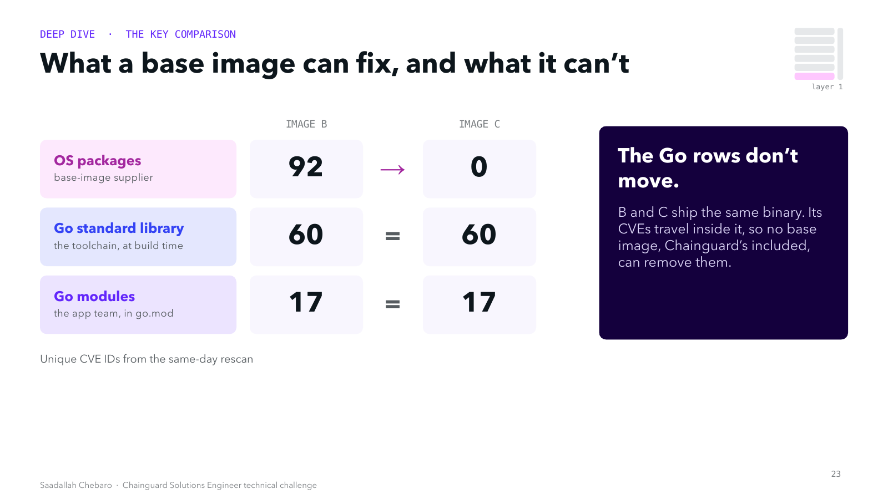

govulncheck confirms it from Go's side. On the shipped binary it finds 62 vulnerabilities whose code is in the file: 49 in the standard library, 12 in `golang.org/x/net` and 1 in `golang.org/x/text`. The same code built with Go 1.27.4 leaves 11, all in `x/net`; updating the modules as well leaves none (D and E). The remaining fix is in Go and `go.mod`, not in the base image.

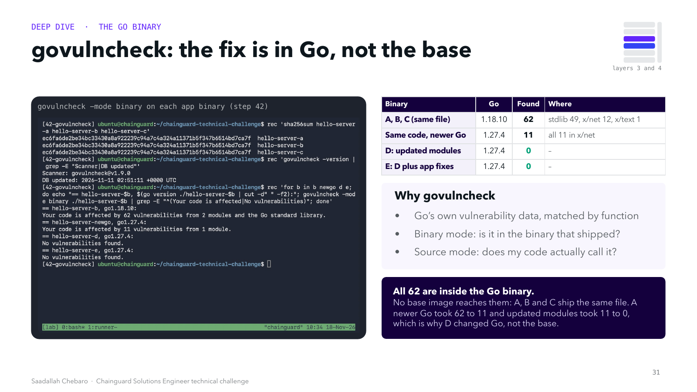

## Image E: what no scanner sees

D and E scan the same: zero, with the same modules. E fixes three things in the app's own code and settings that no scanner reports, each tested on D and E side by side:

- **Debug mode (F1).** D's Gin runs in debug mode and warns about it at startup; E sets `GIN_MODE=release`.
- **Trusting every proxy (F2).** D logs a forged client address from `X-Forwarded-For`; E calls `SetTrustedProxies(nil)` and logs the real one.
- **No server timeouts (F8).** D still holds a half-sent request open after 10 seconds; E runs an `http.Server` with timeouts and closes it after 5.

These are the customer's code and settings: no base image fixes them. E is the image that is signed, attested and deployed.

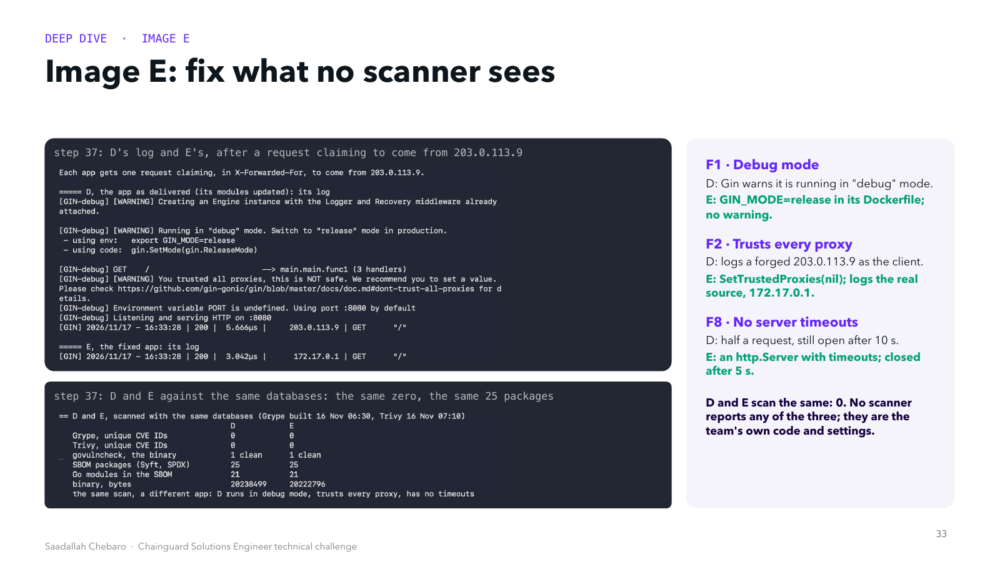

## Supply chain: SBOMs, a registry, signatures and provenance

- **SBOMs.** Syft writes an SPDX and a CycloneDX SBOM for every image ([`sbom/`](sbom)). Grype can scan an SBOM on its own, but for Go it then matches by module version rather than by function, so the count is higher: image C gives 69 from the image and 158 from its SBOM (F23).
- **A local registry.** `registry:3` on the build VM, pinned by digest. C, D and E are pushed to it, and the cluster pulls E by digest.
- **Signatures.** Each Chainguard base image's signature is verified with cosign before use, and the base is pinned by digest. Image E is signed by digest with the lab's own key pair ([`cosign.pub`](cosign.pub); the private key never enters the repo), and its SPDX SBOM is attached to it as a signed attestation ([`reports/signing/`](reports/signing)). C and D are never signed. The signature isn't in a transparency log, so its time can't be checked independently; keyless signing from CI fixes that in production.
- **Provenance.** Chainguard's SLSA provenance for `static` and `go` is verified (step 22b). E's own provenance is BuildKit's default: unsigned, with an empty builder ID (F24). Building in CI from a clean checkout is the fix.

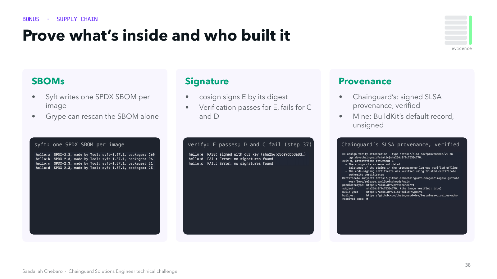

## Kubernetes: the cluster runs only what I signed

The k3s cluster runs image E from the build VM's registry, by its signed digest: a Deployment of two pods and a Service ([`k8s/`](k8s)).

- **Restricted Pod Security** is enforced on the namespace: a non-root user (65532), a read-only root filesystem, every capability dropped, no privilege escalation, seccomp `RuntimeDefault`, and CPU and memory limits. A pod without these settings was refused (step 19).
- **Signature admission.** A Kyverno `ImageValidatingPolicy`, `require-lab-signature`, refuses any pod whose image from the lab registry isn't signed with the lab key: unsigned C and D are refused, E is admitted. One gap is documented and still open: a debug container added to a running pod gets past it (F32).
- **Drift check.** `tools/check-manifests.sh` checks that the manifests in `k8s/` match what the cluster runs, the digest and its signature included.

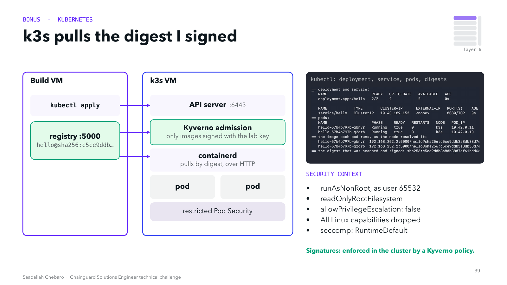

## Beyond the brief: a pipeline with a coding agent

The brief ends at a signed image running in a cluster. I added the step before it: a CI pipeline in which a coding agent writes the change, and a supply-chain gate, not the agent, decides what ships. It runs on a second app, `hello-ai`, a small FastAPI service in a private GitHub repository; [`ci/`](ci) holds a snapshot of it at the commit that last deployed.

- **The gate** ([`gate.sh`](ci/hello-ai/gate.sh)) runs on every pull request, on a self-hosted GitHub Actions runner on the build VM. It has seven checks: Chainguard base images pinned by digest; Chainguard's signature on each; every dependency pinned to an exact version; nothing released in the last 7 days; the image builds; it runs as a non-root user; and Grype finds no fixable high or critical CVE.
- **The deploy** ([`deploy.yml`](ci/hello-ai/.github/workflows/deploy.yml)): after a merge to `main`, the gate runs again, then [`deploy.sh`](ci/hello-ai/deploy.sh) pushes the image to the lab registry, signs it by digest with cosign and deploys it to k3s, where the Kyverno policy admits only images signed with the lab key.
- **The agent** (step 21) is Claude Code, run headless (`claude -p`) as a fresh session each time. It may read and write files but has no git, so a person reviewed and pushed each change. Asked to write a Dockerfile and add `httpx`, with no rules in view, it chose `python:3.13-slim`, and the gate failed three checks: base image, base signature and scan. Given the failed log, it moved to Chainguard images pinned by digest, using `dfc` and `crane`. That build failed, and after a review (the build error and two review notes) the gate passed 7 of 7. The change was merged, signed and rolled out. Every run is listed in [`ci/README.md`](ci/README.md), and what the agent was asked and wrote is in [`ci/agent-runs/`](ci/agent-runs).
- **The skill gate** (step 24). An agent skill is a new kind of third-party dependency, so no skill reaches the agent until NVIDIA SkillSpector has scanned it. A look-alike skill with a hidden prompt injection was blocked at risk 100/100, and the vetted one was allowed ([`ci/skills/`](ci/skills)).
- **What it doesn't cover yet.** The runner holds Docker, the cluster's admin config and the signing key (F27), and a free private repository can't enforce branch protection (F28). Production's answer: ephemeral runners, keyless signing and required checks.

The [demo console](#the-demo-console-the-ci-demo-the-presentation-and-the-command-deck) runs this pipeline step by step in a browser, live or as a replay of the recorded run.

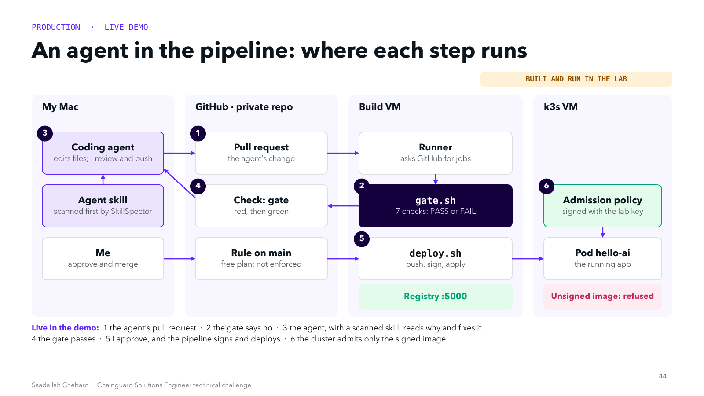

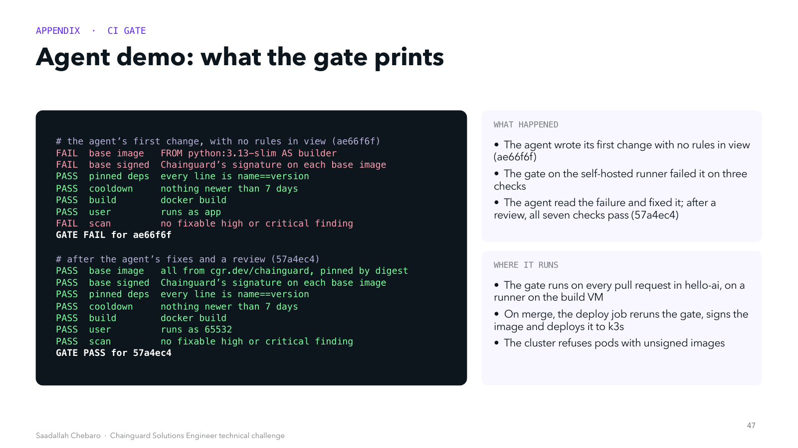

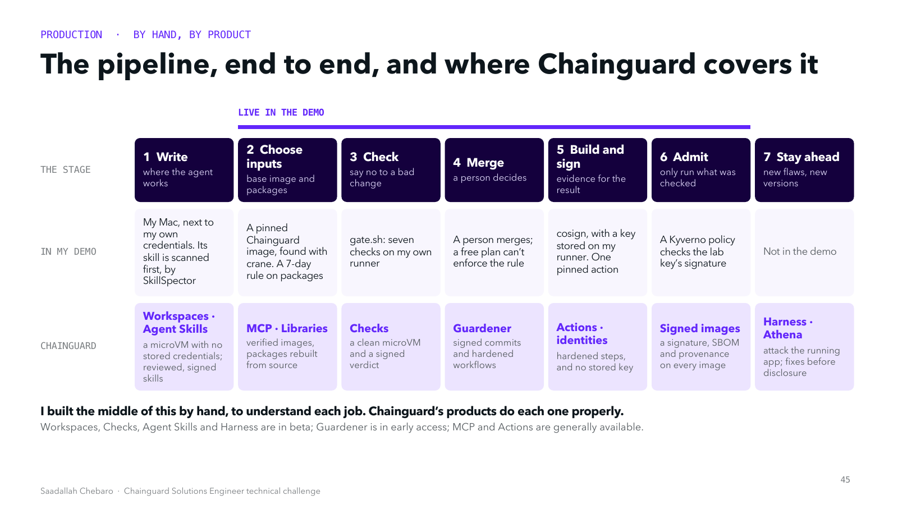

## What Chainguard solves, and what stays with the team

Chainguard's images removed the OS layer and supplied a current, signed Go builder, with SBOMs and provenance for each image. What stays with the team: `go.mod` and dependency updates, the app's code and its settings, deployment and runtime policy, and keeping digest pins current, with Digestabot or Renovate. Not "zero CVEs forever", but "the CVEs that are left are the ones you own".

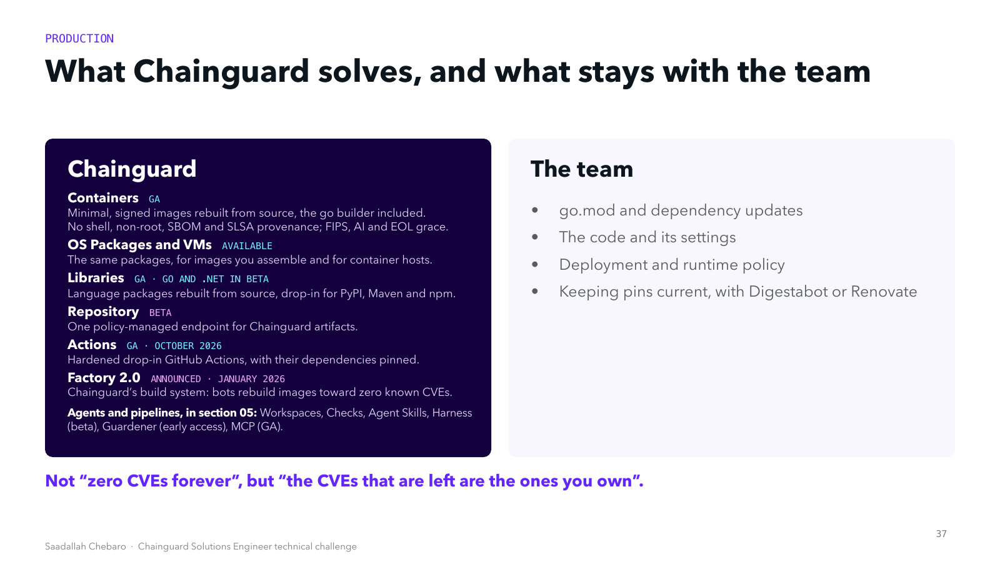

## What the brief asks for, and where it is

| The brief | In this repo |
|---|---|
| A Linux VM, a container engine, and the reasoning behind the tools | [REPORT.md](REPORT.md) §2; [JOURNAL.md](JOURNAL.md) steps 00–05 |
| A single-stage and a multi-stage Dockerfile | [`dockerfiles/`](dockerfiles): A and B, plus C, D, E and the E-golang experiment |
| Scan both containers, document the vulnerabilities, compare | `reports/before/`; REPORT §4 and §6; JOURNAL steps 09–10 |
| Patch the app and its dependencies, update the base images, rescan | `go-updated/` (D) and `go-patched/` (E); Dockerfiles C, D and E; `reports/after/` and `reports/final/`; REPORT §5 |
| Run as a standalone container and validate it | REPORT §4 (run checks and code-fix tests); every image answered "Hello World!" during the final rescan (`hello_world` in `results.json`) |
| Scan reports, before and after | `reports/before/` (A, B), `reports/after/` (C, E, the builders and D's source govulncheck), `reports/final/` (all five): JSON, SARIF and a table for each. The largest image-A files are gzipped: `gunzip -k reports/final/a-grype.json.gz` |
| Findings and methodology | [REPORT.md](REPORT.md) and, in long form, the full report and its executive edition in [`docs/`](docs), with every command in [RUNBOOK.md](RUNBOOK.md) and what happened at each step, surprises included, in [JOURNAL.md](JOURNAL.md) |
| Bonus: SBOMs | [`sbom/`](sbom): SPDX and CycloneDX for each image, Chainguard's signed SBOM for the base, and the SBOMs shipped inside images D and E; JOURNAL steps 15 and 37 |
| Bonus: a registry | A local `registry:3` holding C, D and E, pushed by tag; the cluster pulls E by its signed digest; JOURNAL steps 16 and 37 |
| Bonus: signing | Image E signed by digest with our key ([`cosign.pub`](cosign.pub)), plus a signed SBOM attestation; D, never signed, is refused by the cluster; `reports/signing/`; JOURNAL steps 17 and 37 |
| Bonus: Kubernetes | A k3s cluster on its own VM (JOURNAL step 18) running image E by its signed digest under the restricted Pod Security level; manifests in [`k8s/`](k8s), checked against the cluster with `tools/check-manifests.sh`; JOURNAL steps 19 and 32 |
| Beyond the brief: a pipeline | A gate on every pull request, signing on merge, and a cluster that admits only signed images: [`ci/`](ci) (a snapshot of the private `hello-ai` repo); JOURNAL step 20 |
| Beyond the brief: an agent in the pipeline | A coding agent's change refused by the gate, fixed by the agent and deployed: [`ci/agent-runs/`](ci/agent-runs); the live run sheet in [`demo/demo.md`](demo/demo.md); JOURNAL step 21 |

## Repo layout

```
CHALLENGE.md        the challenge brief, as received
README.md           this page
docs/               the presentation (PDF), and the findings report in two editions, full and executive (PDF and Word);
                    docs/images/ holds the slide pictures on this page
REPORT.md           findings and methodology
JOURNAL.md          one entry per lab step, with the surprises and findings registers at the top
RUNBOOK.md          every command, in order
results.json        the final numbers, generated by tools/results.sh
go/                 the original app, never edited (images A, B and C)
go-updated/         the original app with updated modules (image D)
go-patched/         the same modules and the fixed app (image E)
dockerfiles/        Dockerfile.a-single, .b-multi, .c-chainguard, .d-updated, .e-patched, and two experiments: .e-golang, .c-distroless
reports/before/     first scans of A and B, plus govulncheck and the CISA KEV catalog
reports/after/      first scans of C and E, D's source scan, the builder images, and the compiler-only measurement
reports/final/      the rescan of all five, scanner versions, and comparison.md: the images, the counts,
                    and Grype against Trivy ID by ID, with why they differ (tools/comparison.py)
reports/sbom/       Grype's scans of the SBOMs, for comparison with the image scans
reports/distroless/ image C on Google's distroless static base against Chainguard's, measured (tools/compare-bases.sh)
sbom/               SBOMs: SPDX and CycloneDX for A to E, Chainguard's signed base SBOM, the SBOMs inside image E
reports/provenance/ Docker's default build provenance for image E, as stored in the registry
reports/signing/    verification of E's signature and of its signed SBOM, and the registry objects that hold them
cosign.pub          the public key that verifies image E (the private key never enters the repo)
k8s/                deployment.yaml and service.yaml: image E on Kubernetes, by digest, restricted Pod Security
ci/                 the pipeline bonus: a snapshot of the hello-ai repo (gate, deploy, workflows, policy) and resolve.py
demo/demo.md        the run sheet for the live agent demo
demo/console/       the demo console: local web pages that run each demo step and each quick answer from a button,
                    and a command deck that types the answers into a terminal on the shared screen (see its README)
showcase/           links to the files worth opening during the talk, grouped and numbered (tools/make-showcase.sh)
chainguard-lab.code-workspace   the VS Code workspace for the talk: the showcase, the repo, a terminal per image
demo/screenshots/   screenshots of each step, NN-what.png
logs/               the raw record of each step: every command, its output and exit code
tools/              count.sh, compare.sh, triage.sh, gap-analysis.sh, results.sh, versions.sh, and the lab
                    recording helpers (labrc.sh, bootstrap-vm.sh, tmux.conf, shot.sh, sync-to-mac.sh), make-showcase.sh, show-fixes.sh
                    (the app as delivered, image D, against the fixed app, image E, live), debug-e.sh (getting into the
                    shell-less E, and the side door)
                    and check-manifests.sh (do the manifests in k8s/ match what the cluster runs?)
```

## Reproduce it

The lab ran on an Ubuntu 24.04 VM (arm64) with Docker Engine 29, Go 1.27.4, Grype 0.121.3, Trivy 0.76.2, govulncheck v1.9.0, crane and cosign; [REPORT.md](REPORT.md) §2 has the versions and why each was chosen. Every command is in [RUNBOOK.md](RUNBOOK.md). The images:

```bash
docker build -t hello:a -f dockerfiles/Dockerfile.a-single ./go
docker build -t hello:b -f dockerfiles/Dockerfile.b-multi ./go
docker build -t hello:c -f dockerfiles/Dockerfile.c-chainguard ./go
docker build -t hello:d -f dockerfiles/Dockerfile.d-updated ./go-updated
docker build -t hello:e -f dockerfiles/Dockerfile.e-patched ./go-patched
docker run -d -p 8083:8080 --name hello-e hello:e && curl localhost:8083
```

The final rescan and `results.json`: RUNBOOK step 14.

### Rebuild it yourself

[RUNBOOK.md](RUNBOOK.md) has every command in order, from preparing the Mac (step 00) onwards: each download with its checksum or signature check, and each config file written inline. Six things will differ on your machine:

- **The scan counts.** Scanner databases change every day, so today's Grype and Trivy will give different numbers. The recorded counts used the databases dated in [`results.json`](results.json): Grype's built 2026-11-16 06:30 UTC, Trivy's updated 07:10 UTC. To keep one database for a whole session, turn off Grype's updates as RUNBOOK step 38 does (`~/.config/grype/config.yaml`).
- **The pinned Chainguard digests.** Dockerfiles C, D and E pin `cgr.dev/chainguard/static` and `cgr.dev/chainguard/go` by digest. If a pinned digest is no longer served, take the current one with `crane digest` and verify its signature with `cosign verify` before using it, as in RUNBOOK steps 11 and 13.
- **The addresses.** Multipass picks each VM's address. Where the lab uses 192.168.252.2, the build VM and its registry, use yours: in `k8s/deployment.yaml`, the k3s `registries.yaml` (RUNBOOK step 18), the Kyverno policy in `ci/hello-ai/policy/`, `ci/hello-ai/deploy.sh`, `tools/debug-e.sh` and the demo console (`demo/console/`).
- **The architecture.** The lab ran on Apple Silicon, so its downloads are arm64 builds. On an x86 machine, take the amd64 ones: Go, the scanners, the tools and the runner.
- **The pipeline.** `hello-ai` is a private repository on my account, and [`ci/hello-ai/`](ci/hello-ai) is its snapshot. To run the pipeline, push that folder to a repository of your own, register a self-hosted runner on the build VM with that repository's registration token, add a `COSIGN_PASSWORD` secret holding your signing key's password, and install Kyverno and the policy (RUNBOOK step 20). Point the demo console at it with `CONSOLE_REPO`, `CONSOLE_GH_USER` and `HELLO_AI`.
- **The coding agent.** The live agent steps need a coding agent's command-line tool (`AGENT_BIN`, `claude` by default). Replay mode, and the agent's recorded change, work without one.

### Open the lab in VS Code

Both VMs are reachable over SSH from the Mac with a key used only for the lab (`~/.ssh/chainguard_lab`), as `chainguard-lab` (the build VM, 192.168.252.2) and `k3s-lab` (192.168.252.3) in `~/.ssh/config`. With Microsoft's Remote-SSH extension, this opens the repo on the build VM, next to its images, registry and reports:

```bash
code --folder-uri "vscode-remote://ssh-remote+chainguard-lab/home/ubuntu/chainguard-technical-challenge"
```

VS Code then offers the extensions in `.vscode/extensions.json` on the VM side: Container Tools (images, containers, the registry on :5000), Kubernetes (the k3s cluster, through `~/.kube/config` on the build VM) and YAML.

For the talk, open the workspace instead. It puts [`showcase/`](showcase) first: one folder of the files worth opening, numbered `01-dockerfiles` to `09-lab-notes`, each a link to the real file (rebuild it with `tools/make-showcase.sh`). Its terminal menu has a shell in the lab folder, a shell inside image A or B, a sidecar for C or D (they have no shell), and `kubectl` for the cluster:

```bash
code --file-uri "vscode-remote://ssh-remote+chainguard-lab/home/ubuntu/chainguard-technical-challenge/chainguard-lab.code-workspace"
```

## The demo console: the CI demo, the presentation and the command deck

[`demo/console/`](demo/console) is a small local web app, used live in the talk, that runs every demo step and every proof from a button. Its output streams into a terminal panel on the same page, or into a real terminal. It has three pages:

- **CI demo** (`/ci`): the [pipeline with a coding agent](#beyond-the-brief-a-pipeline-with-a-coding-agent), step by step, from a clean branch (step 0) to the signed image running and Chainguard's products mapped onto the pipeline (step 12). The diagram shows where each part runs, and the gate's checks and the deploy steps turn green or red from the real output as it arrives. **Live** runs the real commands; **Replay** plays back the recorded run of 16 November; **Play all** runs every step hands-off.
- **Full presentation** (`/present`): one section per part of the deck, each with proofs that run on the lab VMs in seconds, most of them read-only. Its first section, **Show me: quick answers**, has 132 one-click commands for likely questions, in 15 groups: the Dockerfiles and source, images and layers, building, running and scanning live, E's fixes (D against E), the registry, the scan reports, SBOMs, signatures and provenance, signing and deploying live, Kubernetes, the pipeline, agent skills and the lab notes. The live groups write only throwaway things, such as `hello-live` images and their signature; the recorded evidence is never touched.
- **Command deck** (`/deck`): the same commands as buttons only, 135 of them, for a second screen. Each button types its command into a real terminal, by default the tmux session `show` on the build VM, so the answer appears in a terminal the audience can read. Three need a person at the keyboard, so only the deck offers them: signing with the lab key, which asks for the key's password, and a shell inside image A or B.

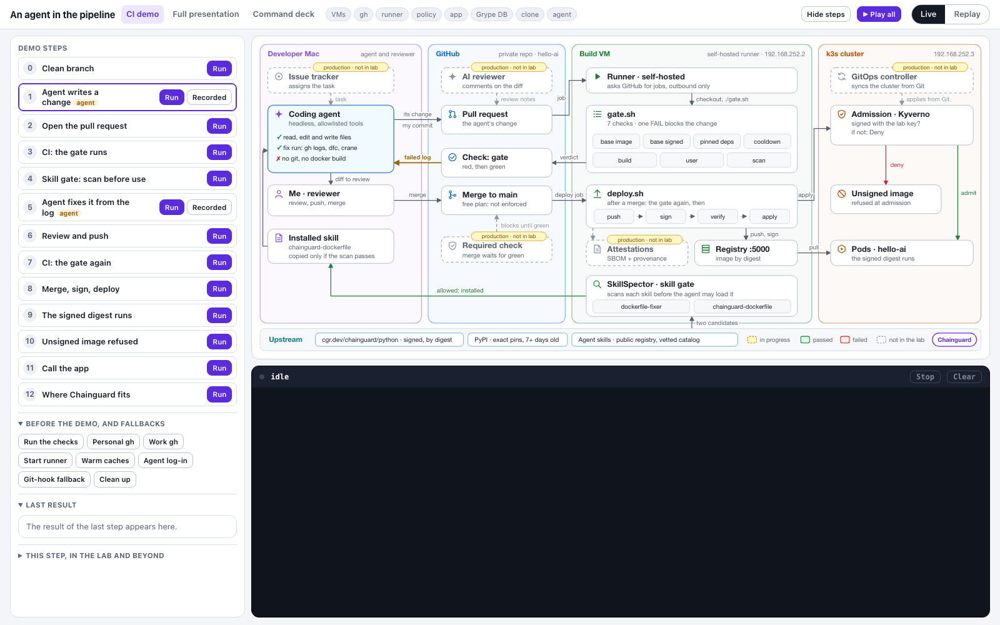

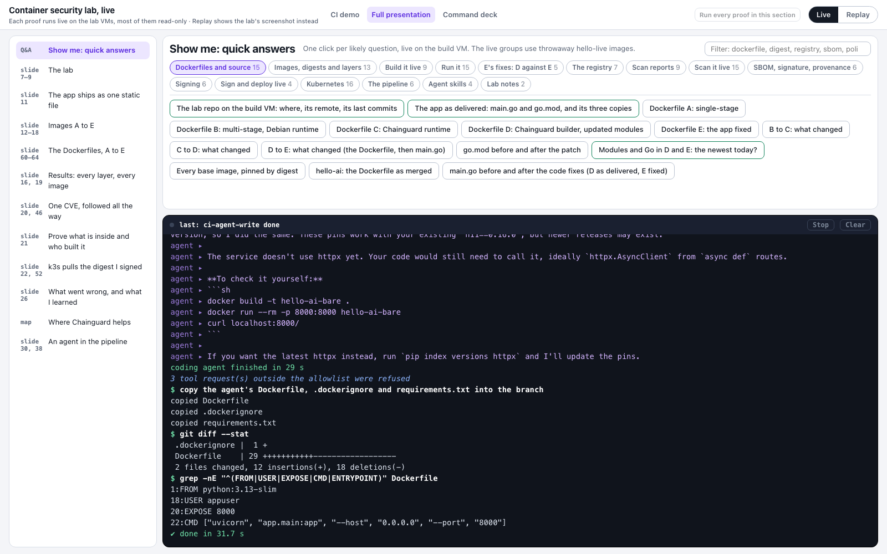

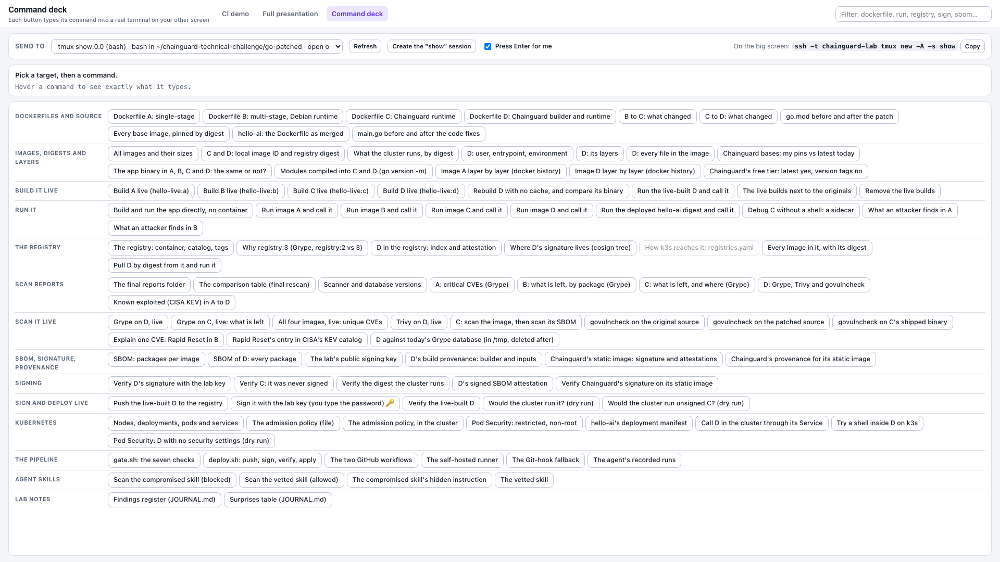

### Run it

On the Mac, from the lab checkout, with both VMs running (`multipass start chainguard k3s`) and Node 18 or newer; there are no packages to install:

```bash
node demo/console/server.js
```

Then open <http://127.0.0.1:8077/>, and stop it with Ctrl+C. It listens on 127.0.0.1 only, and every command it can run is fixed in `demo/console/actions/`: nothing typed in the browser is executed. The CI demo in Live mode also needs `gh` logged in to the account that owns `hello-ai`, a clone of `hello-ai` next to the lab checkout, the self-hosted runner started, and the agent's command-line tool logged in; the page's **Run the checks** and **Agent log-in** buttons check them. [`demo/console/README.md`](demo/console/README.md) has the details, and [`demo/demo.md`](demo/demo.md) is the run sheet, with a fallback for each step.

### The tmux sessions

Two tmux sessions on the build VM:

- **`lab`**, the recorder, where the lab was run. [`tools/bootstrap-vm.sh`](tools/bootstrap-vm.sh) creates it and loads [`tools/labrc.sh`](tools/labrc.sh) into every shell: `step 09-scan-ab` starts a step's log, and `rec 'command'` runs a command and writes it to `logs/` with its time, folder, output and exit code. The self-hosted runner runs in its window `runner`.

  ```bash
  multipass shell chainguard
  tmux attach -t lab
  # if the runner isn't running:
  tmux new-window -d -n runner -t lab "cd ~/actions-runner && ./run.sh 2>&1 | tee -a ~/ci/runner.log"
  ```

- **`show`**, the command deck's target. Press **Create the "show" session** on the deck once, then attach to it on the screen the audience sees, and keep it full screen:

  ```bash
  ssh -t chainguard-lab tmux new -A -s show
  ```

  Or, in VS Code with the lab workspace open over Remote-SSH, open a terminal with the profile **Command deck: show session**. The first time the deck types into the session, it moves to the lab folder and puts Go on the PATH, in plain sight. `chainguard-lab` is the SSH host for the build VM, set up in RUNBOOK step 24.

## How this was built

I built the lab with an AI coding assistant, Claude Code, working alongside me: it drafted commands, scripts and documents, and ran commands in the recorded terminal session on the build VM. Every command and its output is in [`logs/`](logs), and every number in the deck, the reports and this page comes from those logs and the files in [`reports/`](reports).

Separately, the pipeline in [`ci/`](ci) uses a coding agent as the developer, on purpose: whether a gate can keep an agent's changes safe is what JOURNAL step 21 tests.
